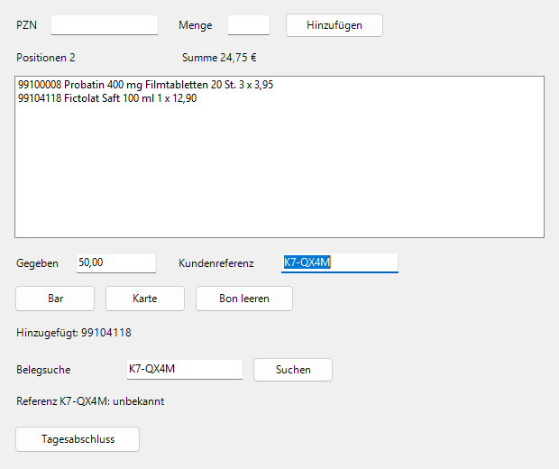

# Apotheken-Werkbank

Übungs- und Portfolio-Projekt rund um die Automatisierung deutscher Vor-Ort-Apotheken. Kein
Produkt, kein Kunde, keine echten Daten: Kasse und Grosshandel sind Attrappen, alle Artikel,
Rezepte und Apotheken sind erfunden.



## Was drin ist

| Teil                                               | Was es tut                                                                                                                                              |
| -------------------------------------------------- | ------------------------------------------------------------------------------------------------------------------------------------------------------- |
| [Engine](docs/ENGINE.md) (`engine/`, PowerShell 7) | Bedient eine Windows-Kasse nur über Bildschirmfoto, OCR und Eingabe. Flows je Apotheke als YAML, nie doppelt buchen, Selbstheilung mit Claude Haiku 5.5 |
| Kassen-Attrappe (`attrappe/`)                      | Ziel der Engine: WinForms-Fenster in zwei Layouts (zwei Apotheken) und dieselbe Kasse als Simulation für Tests                                          |
| Bestell-Tool (`web/`, `grosshandel-attrappe/`)     | Verfügbarkeit und Bestellung über MSV3 gegen einen eigenen MSV3-Server mit Mandanten ([MSV3.md](docs/MSV3.md))                                          |
| Kassentool (`web/`)                                | Kasse mit Beleg als PDF, Storno, Tagesabschluss; Rechte je Apotheke in der Datenbank ([KASSE.md](docs/KASSE.md))                                        |
| Flow-Monitor (`web/`)                              | Läufe der Engine mit Schritten, Selbstheilung und Bildschirm beim Abbruch                                                                               |
| [Prototyp](prototypen/rezept-zur-kasse/README.md)  | Rezeptdatensatz zur Kasse, in zwei Stunden nach [festem Rezept](docs/PROTOTYP-REZEPT.md)                                                                |

Technik: Next.js 16, React 19, TypeScript, Supabase (Postgres mit RLS), Vercel; PowerShell 7 mit
Pester, `Windows.Media.Ocr` und `SendInput`; GitHub Actions auf Linux und Windows.

## Starten

Die Engine mit dem Test-Treiber, ohne Windows:

```bash
pwsh engine/werkzeuge.ps1
pwsh engine/werkbank.ps1 lint
pwsh engine/werkbank.ps1 run -Apotheke nord -Flow verkauf -Auftrag flows/beispiele/verkauf-bar.json -Treiber fake
```

Die Web-App lokal (braucht Bun, Node 24 und Docker):

```bash
bun install
bunx supabase start && bun run einrichten && pwsh engine/monitor-fuellen.ps1
MANDANTEN_DATEI=$PWD/.lokal/mandanten.json bun run grosshandel & (cd web && bun run dev)
```

Die Web-App läuft dann auf http://localhost:3500, die Grosshandel-Attrappe auf Port 3501. Die
Testkonten stehen in `.lokal/konten.json`, nie im Repo.

## Wie geprüft wird

Tests zuerst, dazu eine Sabotage für jede Schutzfunktion: Ein absichtlich eingebauter Fehler muss
den passenden Test rot machen. Die CI prüft Geheimnisse, Format, Typen, Unit-, Datenbank- und
Browser-Tests in vier Breiten mit axe und Lighthouse, die Engine mit Pester und PSScriptAnalyzer,
und echte Läufe auf einem Windows-Läufer gegen das Fenster der Kassen-Attrappe.
([ARBEITSWEISE.md](docs/ARBEITSWEISE.md), [FALLSTUDIE.md](docs/FALLSTUDIE.md))

## Weiterlesen

- [Überblick](docs/UEBERBLICK.md): die drei Arbeitsfelder und was das Bauen gelehrt hat
- [Entscheide](docs/ENTSCHEIDE.md) mit Grund und Preis
- [Fragen und Antworten](docs/FRAGEN.md)
- [Sicherheit](docs/SECURITY.md) und [Betrieb](docs/BETRIEB.md)

## Lizenz

Alle Rechte vorbehalten, siehe [LICENSE](LICENSE).
