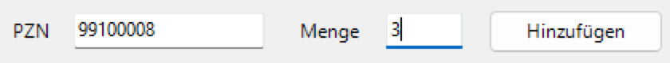

# Fallstudie: eine Kasse ohne Schnittstelle bedienen

Übungsprojekt, gebaut vom 26. bis 29.10.2026. Die Kasse ist eine Attrappe, alle Daten sind
erfunden. Diese Seite erzählt, wie die Engine entstand, was gemessen wurde und was dabei
schiefging. Technik im Detail: [ENGINE.md](ENGINE.md); Entscheide mit Grund und Preis:
[ENTSCHEIDE.md](ENTSCHEIDE.md), E30 bis E41.

## Die Frage

Lässt sich eine Windows-Kasse ohne Schnittstelle so bedienen, dass sie nie doppelt bucht und
jeden Abbruch mit einem Bild des Bildschirms meldet? Und lässt sich das prüfen, ohne echte Kasse
und ohne eigenen Windows-Rechner?

## Ergebnis in Zahlen

| Was                     | Ergebnis                                                                                                                                                |
| ----------------------- | ------------------------------------------------------------------------------------------------------------------------------------------------------- |
| Flows                   | 4: Verkauf und Tagesabschluss für zwei Apotheken mit verschiedenem Layout; ein Verkauf hat 16 oder 17 Schritte                                          |
| Echte Läufe auf Windows | 8 Tests gegen das WinForms-Fenster auf `windows-2025`, alle grün; ein Verkauf mit zwei Positionen 27 bis 39 s, «bereits gebucht» 7 s, ein Abschluss 6 s |
| OCR                     | 20 von 20 Prüfwörtern dreifach hochskaliert, 18 von 20 in echter Grösse; etwa 1 bis 1,5 s je Bild                                                       |
| Tests                   | Pester 141 ohne Bildschirm, Unit 157, Datenbank 79, Browser 121 (drei Breiten und dunkel)                                                               |
| Sabotagen               | 77, alle gefangen: 33 an Engine und Kassen-Attrappe, 21 an der Datenbank, 23 im Code der Web-App                                                        |
| Selbstheilung           | Claude Haiku 5.5, etwa 0,0002 $ je Vorschlag; ausgeführt werden nur Ziele aus der Liste des Flows                                                       |
| Prototyp                | 10 erfundene Rezeptdatensätze: 5 gebucht, 1 Doppel erkannt, 4 mit Grund für einen Menschen                                                              |

## Vorgehen

1. **Ziel zuerst.** Eine Kassen-Attrappe als WinForms-Fenster in zwei Layouts, dazu dieselbe Kasse
   als Simulation aus demselben Code. Die Simulation liefert Wörter mit Lage, wie eine OCR sie
   liefert; so laufen alle Flows in Pester auf dem Mac und unter Linux.
2. **Gate vor dem Bau.** Eine Probe auf einem Windows-Läufer von GitHub prüfte, ob Bildschirm,
   OCR, Klick und Eingabe dort gehen (E32). Erst danach entstand die Engine.
3. **Die Regeln gegen doppeltes Buchen vor allem anderen:** kritischer Schritt, «unklar», die
   Kennung des Auftrags als Referenz auf dem Beleg (E33). Danach Dialoge, Wiederholung,
   Selbstheilung und der Flow-Monitor.
4. **Jede Schutzfunktion einmal kaputt.** Für jede eine Sabotage; der passende Test muss rot
   werden ([ARBEITSWEISE.md](ARBEITSWEISE.md)).
5. **Echte Läufe als letztes Tor.** Ist Linux grün, laufen die Tests gegen das echte Fenster auf
   Windows, mit Bildfolge und Journal der Kasse als Artefakt. Was gebucht wurde, prüfen sie am
   Journal, nicht an der OCR.

## Was schiefging

**Die Schreibmarke.** Der erste echte Lauf auf Windows brach alle sechs Verkäufe ab, jedes Mal
mit «Eingabe nicht sichtbar»; nur die beiden Tagesabschlüsse liefen durch. Zwei Ursachen steckten
darin. Die erste: Die blinkende Schreibmarke klebt am letzten Zeichen des Feldes mit dem Fokus.
Kennungen im Suchfeld stimmten darum erst beim zweiten oder dritten Bild, in Süd gar nicht, je
nachdem, ob die Marke beim Bildschirmfoto gerade an war. Keine Simulation hatte das gezeigt, weil
keine eine Marke zeichnete.

Jetzt verlässt `eingeben` das Feld vor der Prüfung und kehrt danach zurück. Im nächsten Lauf
stimmte jede Kennung beim ersten Versuch, und Süd buchte alles. Die Simulation zeigt die Marke als
Chaos, ein Test und eine Sabotage halten den Fall fest (E37).

**Eine «1» hinter «Menge».** Nord scheiterte im zweiten Lauf weiter, an derselben Stelle wie im
ersten: Die OCR fand die Menge «1» im Feld nicht, die «3» davor schon. Süd las dieselbe «1» in
jedem Lauf; dort steht die Beschriftung über dem Feld, in Nord daneben. Zuerst hatte ich auch das
der Schreibmarke zugeschrieben, weil ein Foto eine Marke hinter einer Ziffer zeigte. Der Lauf ohne
Marke widerlegte das. Erst als die Engine in der Fehlermeldung nannte, was die OCR im Feld las,
und eine Probe dieselbe Zeile in drei Grössen las, war die Ursache klar: zwei- und vierfach steht
die «1» da, dreifach fehlt sie. Die Engine liest jetzt vor einem Fehlschlag das letzte Bild noch
einmal vierfach (E38).

**Eine Lücke gegen doppeltes Buchen.** Bei der Arbeit an der «1» fiel auf: Der Verkaufs-Flow
beendete den Lauf nur, wenn er die Zeile «Referenz …: Beleg» las. Fehlte sie in einem einzigen
Bild, verkaufte er ein zweites Mal. Ein Test mit einer flackernden Zeile zeigte genau das, zwei
Belege für eine Kennung. Jetzt verkauft der Flow nur, wenn «unbekannt» sicher dasteht, sonst bricht
er ab (E39).

**Was die zweite Durchsicht fand.** Vor dem Merge prüfte ein zweiter Agent den ganzen Pull Request
und fand neun Befunde. Der schwerste: Die Engine verglich Zahlen unscharf, «Positionen 1» galt als
«Positionen 2». Ging ein Enter verloren, meldete der Lauf «ok», und auf dem Beleg fehlte eine
Position. Dazu kamen ein Tagesabschluss, der bei fehlender Bestätigung «abgebrochen» statt «unklar»
hiess, ein Trockenlauf, der Dialoge wegklickte, und eine Selbstheilung, die nach der Antwort des
Modells auf einem alten Bild klickte. Alle neun sind behoben, jeder mit einem Test, der vorher rot
war (E40, E41, [SECURITY.md](SECURITY.md)). Einer dieser Tests war zuerst aus dem falschen Grund
grün: Ihm fehlte ein Import, der Lauf brach an diesem Fehler ab, und der Test sah den erwarteten
Abbruch. Erst mit dem Import wurde er rot, wie er sollte. Zwei der Fixes brauchten auf Windows eine
zweite Runde: Die Zahlenregel war zu streng, weil Süd «Im» als «1m» las, und ohne eine zufällige
Pause der alten Vordergrund-Logik klickte die Engine einen Dialog zweimal, weil er im nächsten Bild
noch dastand. Beides fand der echte Lauf, nicht die Simulation; jetzt kennt die Simulation das
Nachbild eines Dialogs.

**Warten wiederholt.** Die erste Fassung wiederholte auch reine Warteschritte. Im Test
verdreifachte das die Frist, und ein Lauf, der «unklar» melden sollte, meldete «ok». Warten wird
seither nicht wiederholt (E33).

**Alte Meldungen.** Die Engine merkte vor jeder Aktion alle sichtbaren Fehlermeldungen als alt.
Nach «Ohne Rezept nicht abgegeben» lief ein Verkauf darum weiter und buchte eine von zwei
Positionen. Jetzt ist nur alt, was beim Start des Laufs schon dastand, und nur bis es verschwindet
(E34).

**Ein Test, der nicht prüfte, was er versprach.** Die Sabotage «kritischer Schritt wird nach dem
Senden wiederholt» blieb grün: Kein Flow der Tests liess einen buchenden Schritt nach dem Senden
scheitern. Ein neuer Test baut den Fall mit einem Flow im Speicher nach; seither wird die Sabotage
rot.

**Werkzeuge.** PSScriptAnalyzer stürzte nur unter Linux an einem Modul-Manifest ab; die Regel ist
mit Grund aus, ein Pester-Test prüft die Manifeste. Deutsch für die OCR nachzuinstallieren brach
nach zwölf Minuten ab; Englisch liest Umlaute, ß und € auch. Die Sabotagen der Engine (damals 22)
brauchten auf dem Läufer 19 Minuten, und mit Pester und Analyse davor sprengten sie die Zeitgrenze
des Jobs von 20 Minuten. Sie laufen jetzt neben den Windows-Läufen statt davor.

## Was es zeigt

- **Simulation und echte Läufe brauchen einander.** Die Simulation macht jeden Flow in Sekunden
  prüfbar, Chaos eingeschlossen; was sie nicht kennt, findet nur das echte Fenster. Jeder Fund dort
  geht als Chaos zurück in die Simulation.
- **Eine Erklärung aus einem Foto ist noch keine Messung.** Die Schreibmarke auf dem Bild passte
  so gut zur fehlenden «1», dass sie als Ursache in der Doku stand. Gemessen war sie nie. Eine
  Fehlermeldung, die sagt, was die OCR wirklich las, hätte den Umweg erspart.
- **«Unklar» ist ein Ergebnis.** Fehlt nach einem buchenden Klick die Bestätigung, rät die Engine
  nicht und klickt nicht noch einmal. Die Kennung auf dem Beleg klärt den Fall beim nächsten Lauf,
  nach demselben Muster wie beim Bestellen über MSV3 (E25).
- **Bei der Selbstheilung liegt die Sicherheit in der Liste, nicht im Modell.** Ein Text auf dem
  Bildschirm kann ein Modell beeinflussen, aber keinen Knopf freischalten, den der Flow nicht
  erlaubt (E35).

## Grenzen

- Die Kasse ist eine Attrappe, die sich bewusst gut automatisieren lässt. Eine echte Kasse ändert
  sich mit Updates und hat Rechte je Benutzer; ihr Flow braucht Bereiche und genauen Vergleich und
  muss nach jedem Update geprüft werden. Wo er bricht, zeigt der Flow-Monitor.
- Jedes Bild kostet etwa 1 bis 1,5 Sekunden, weil die OCR je Bild einen Prozess startet. Ein
  dauernder OCR-Prozess wäre der nächste Schritt.
- Bildschirmfotos einer echten Kasse enthalten Gesundheitsdaten. Sie dürfen nur dorthin, wo die
  Daten bleiben dürfen; das gilt auch für ein Modell der Selbstheilung.
- Die Selbstheilung ist mit einer Attrappe des Modells getestet. Der Lauf gegen die echte API
  braucht einen Schlüssel als GitHub-Secret und läuft nur auf `main` oder von Hand.
